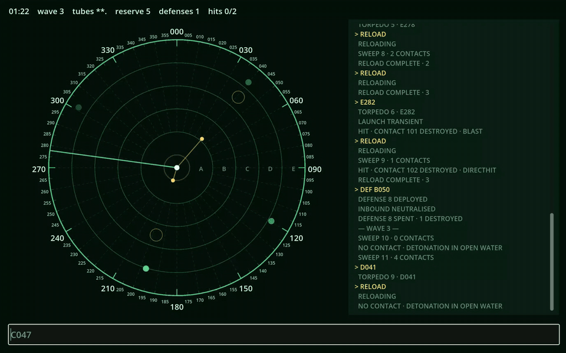

[Español](README.md)

# SONAR

A command-line arcade game: you run a submarine's sonar, you see contacts on a scope that only shows where they were, and you fire by typing the bearing and band where you think they are going to be.



> **Paused prototype** · v0.1.0 · Windows and Linux · English interface · Play it on itch: [cgrassdev.itch.io/sonar](https://cgrassdev.itch.io/sonar)

## How to play

- The sonar beam sweeps in a circle. Each contact shows up as a mark **where it was** when the beam crossed it, not where it is now, and the mark fades over time. You have to work out where it went.
- You fire by typing the bearing in degrees and the range band, from A (close) to E (far): `C047`. The torpedo takes seconds to get there and explodes on the first thing it crosses.
- You have three tubes and a reserve of twelve torpedoes, and you load one at a time with `RELOAD`. Defences (`DEF C047`) stop torpedoes coming at you.
- Enemies listen for you and shoot where you were. Two hits or a collision and it is over. Waves double (one, two, four and eight ships) and it is not meant to be won.

Everything is played with the keyboard: type the command and send it with Enter.

| Command | What it does |
|---|---|
| `START` | Starts the run |
| `C047` | Fires at bearing 047, band C |
| `DEF C047` | Drops a defence there (one at a time) |
| `RELOAD` | Loads a torpedo |
| `SONAR` | Stops or restarts the sweep |
| `STATUS` | Reports ammo and defences |
| `RETRY` | Starts over after you die |

## Context

SONAR is a personal project from August 2026. This version is the **M1 prototype**: it exists to answer a single design question, whether reading a sonar and guessing where the contact is now is fun. That is why the screen is an instrument and nothing else, and why the game logs every run to measure it.

The project is **paused**. The balance is not tuned and the M1 questions (`docs/development/m1-findings.md`) were never answered. It is published as it is, to show what got built.

## How it is made

| | |
|---|---|
| Engine | Godot 4.7 (.NET) |
| Language | C# (.NET 9) |
| Tests | 411, with xUnit |
| Platforms | Windows and Linux |

- **Four layers, one direction:** `Sonar.Game` (Godot) → `Sonar.Autopilot` → `Sonar.Controller` → `Sonar.Core`. Neither the simulation (`Core`) nor the `Controller` references Godot, so they are tested without opening the editor. Godot only draws and takes what you type.
- **Deterministic simulation.** It runs in fixed 1/60 s ticks, with seeded randomness and a fixed update order: the same seed and the same commands give exactly the same run. That makes `RETRY` a clean reset and any run replayable.
- **The screen never knows the truth.** The view only receives the reading from the last sweep, and a test fails if anyone exposes the real position.
- **Enemies with personality.** There are five kinds, defined as data. One circles far away and fires patiently, one closes in, fires and backs off, one fires often and badly to make you spend defences, one arrives late and aims better than the rest, and the last one never fires: it rams you, and you can hear it coming.
- **An autopilot that plays from the screen alone.** `Sonar.Autopilot` remembers readings, estimates velocities and fires where the contact is going to be. It was used to measure where the game becomes impossible, and `make demo` shows it playing on the real scope.
- **Tests checked by breaking the code.** The important properties are verified by breaking the implementation on purpose and confirming that the tests fail.

### 2026 changes (when publishing)

- The exported build did not start: it looked for its configuration outside the Godot project. Now `make export` copies it in and the build carries it packed.
- Added the Windows and Linux export presets (`export_presets.cfg` was in `.gitignore`) and `src/Sonar.Game/Sonar.Game.sln`, which Godot needs to export. `Sonar.sln` still leaves the game out, so `dotnet test` works without Godot.
- `project-state.yaml` marks the project as paused.

### Anonymous log

While you play, the game saves `m1-session.jsonl` (every event) and `m1-session.csv` (a summary) in Godot's data folder: `~/.local/share/godot/app_userdata/Sonar/` on Linux and `%APPDATA%\Godot\app_userdata\Sonar\` on Windows. It holds a random id, the time, the window size, the configuration and the events of the run, but not your username, paths or computer name. It is replaced every time you open the game and **is never sent anywhere**: the game does not use the network.

## Opening and exporting

You need [Godot 4.7 .NET](https://godotengine.org/download/archive/) (on Linux, the `godot-mono` binary; plain `godot` has no C#) with its export templates, and the [.NET 10 SDK](https://dotnet.microsoft.com/download).

```
make run              # opens the game
make demo             # the autopilot plays (SEED, PACE and SPEED can be changed)
dotnet test Sonar.sln # the 411 tests, no Godot needed
make export           # Linux and Windows builds in build/
```

The game's values (speeds, radii, reload) are in `config/simulation.working.json`. In development they are read from there directly, so you can change them and play again without rebuilding.

The v0.1.0 builds are in [Releases](https://github.com/clemgrass/SONAR/releases). The design, decisions and plans for each stage are in `docs/`.

## Credits and license

- **Clemente Grass Briones** ([clemgrass](https://github.com/clemgrass)): design, programming and visual look.

There are no third-party images, audio or fonts: the scope is drawn with code and the typeface is the one that comes with Godot.

**Code:** [MIT](LICENSE).
