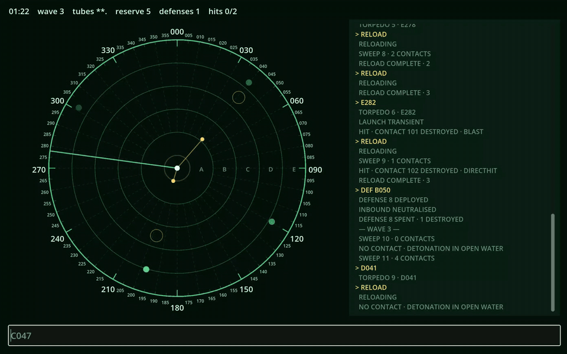

[English](README.en.md)

# SONAR

Un arcade de comandos: eres el operador del sonar de un submarino, ves los contactos en un radar que solo muestra dónde estaban, y disparas escribiendo la marcación y la banda donde crees que van a estar.



> **Prototipo en pausa** · v0.1.0 · Windows y Linux · Interfaz en inglés · Juégalo en itch: [cgrassdev.itch.io/sonar](https://cgrassdev.itch.io/sonar)

## Cómo se juega

- El haz del sonar barre en círculo. Cada contacto aparece como una marca **donde estaba** cuando el haz lo cruzó, no donde está ahora, y la marca se desvanece con el tiempo. Hay que calcular hacia dónde se movió.
- Disparas escribiendo la marcación en grados y la banda de distancia, de la A (cerca) a la E (lejos): `C047`. El torpedo tarda segundos en llegar y explota con lo primero que cruza.
- Tienes tres tubos y una reserva de doce torpedos, y cargas uno a la vez con `RELOAD`. Las defensas (`DEF C047`) detienen los torpedos que vienen hacia ti.
- Los enemigos te escuchan y disparan a donde estabas. Dos impactos o un choque y se acaba. Las oleadas se duplican (una, dos, cuatro y ocho naves) y no está hecho para ganarse.

Todo se juega con el teclado: escribes el comando y lo envías con Enter.

| Comando | Qué hace |
|---|---|
| `START` | Empieza la partida |
| `C047` | Dispara a la marcación 047, banda C |
| `DEF C047` | Suelta una defensa ahí (una a la vez) |
| `RELOAD` | Carga un torpedo |
| `SONAR` | Detiene o reanuda el barrido |
| `STATUS` | Informa la munición y las defensas |
| `RETRY` | Vuelve a empezar después de morir |

## Contexto

SONAR es un proyecto personal de agosto de 2026. Esta versión es el **prototipo M1**: existe para responder una sola pregunta de diseño, si leer un sonar y adivinar dónde está ahora el contacto es entretenido. Por eso la pantalla es un instrumento y nada más, y el juego guarda un registro de cada partida para medirlo.

El proyecto quedó **en pausa**. El balance no está ajustado y las preguntas de M1 (`docs/development/m1-findings.md`) quedaron sin responder. Se publica tal como está, como muestra de lo que se alcanzó a construir.

## Cómo está hecho

| | |
|---|---|
| Motor | Godot 4.7 (.NET) |
| Lenguaje | C# (.NET 9) |
| Tests | 411, con xUnit |
| Plataformas | Windows y Linux |

- **Cuatro capas en una sola dirección:** `Sonar.Game` (Godot) → `Sonar.Autopilot` → `Sonar.Controller` → `Sonar.Core`. Ni la simulación (`Core`) ni el `Controller` referencian Godot, así que se prueban sin abrir el editor. Godot solo dibuja y recibe lo que escribes.
- **Simulación determinista.** Avanza en ticks fijos de 1/60 s, con el azar sembrado y un orden de actualización fijo: la misma semilla y los mismos comandos dan exactamente la misma partida. Así `RETRY` es un reinicio limpio y cualquier partida se puede repetir.
- **La pantalla nunca sabe la verdad.** La vista solo recibe la lectura del último barrido, y hay un test que falla si alguien expone la posición real.
- **Enemigos con personalidad.** Hay cinco tipos, definidos como datos. Uno orbita lejos y dispara con paciencia, otro se acerca, dispara y se aleja, otro dispara seguido y mal para hacerte gastar defensas, otro llega tarde y apunta mejor que el resto, y el último no dispara: se te tira encima, y se le oye venir.
- **Un piloto automático que juega leyendo solo la pantalla.** `Sonar.Autopilot` recuerda las lecturas, estima velocidades y dispara a donde va a estar el contacto. Sirvió para medir dónde el juego se vuelve imposible, y `make demo` lo muestra jugando en el radar real.
- **Tests que se comprueban rompiendo el código.** Las propiedades importantes se verifican rompiendo la implementación a propósito y confirmando que los tests fallan.

### Cambios de 2026 (al publicarlo)

- El build exportado no arrancaba: buscaba la configuración fuera del proyecto de Godot. Ahora `make export` la copia dentro y el build la lleva empaquetada.
- Se agregaron los presets de exportación para Windows y Linux (`export_presets.cfg` estaba en `.gitignore`) y `src/Sonar.Game/Sonar.Game.sln`, que Godot necesita para exportar. `Sonar.sln` sigue sin el juego, para que `dotnet test` funcione sin Godot.
- `project-state.yaml` marca el proyecto como en pausa.

### Registro anónimo

Mientras juegas, el juego guarda `m1-session.jsonl` (cada evento) y `m1-session.csv` (un resumen) en la carpeta de datos de Godot: `~/.local/share/godot/app_userdata/Sonar/` en Linux y `%APPDATA%\Godot\app_userdata\Sonar\` en Windows. Incluye un id al azar, la hora, el tamaño de la ventana, la configuración y los eventos de la partida, pero no tu usuario, rutas ni el nombre del equipo. Se reemplaza cada vez que abres el juego y **no se envía a ninguna parte**: el juego no usa la red.

## Abrirlo y exportarlo

Necesitas [Godot 4.7 .NET](https://godotengine.org/download/archive/) (en Linux, el binario `godot-mono`; el `godot` normal no trae C#) con sus plantillas de exportación, y el [.NET SDK 10](https://dotnet.microsoft.com/download).

```
make run              # abre el juego
make demo             # lo juega el piloto automático (SEED, PACE y SPEED se pueden cambiar)
dotnet test Sonar.sln # los 411 tests, sin Godot
make export           # builds de Linux y Windows en build/
```

Los valores del juego (velocidades, radios, recarga) están en `config/simulation.working.json`. En desarrollo se leen de ahí directamente, así que puedes cambiarlos y volver a jugar sin recompilar.

Los builds de la v0.1.0 están en [Releases](https://github.com/clemgrass/SONAR/releases). El diseño, las decisiones y los planes de cada etapa están en `docs/`.

## Créditos y licencia

- **Clemente Grass Briones** ([clemgrass](https://github.com/clemgrass)): diseño, programación y aspecto visual.

No hay imágenes, audio ni fuentes de terceros: el radar se dibuja con código y la letra es la que trae Godot.

**Código:** [MIT](LICENSE).
